# 이미지 자산, 폰트 파일과 아이콘

[전체 목차](./README.md) · [이전: 3D 형상, 렌더링과 시점 조작](./rendering-and-gestures.md) · [다음: 검증, 전체 인벤토리와 구현 경계](./validation-and-inventory.md)

> 기준: 2026-11-02 원문 가이드의 작업 트리 설명을 종류별로 재분류했습니다. 코드 블록은 실제 소스 발췌이며 독립 실행 예제가 아닙니다. 실제 연결·조건부 표시·보유·미구현의 구분은 그대로 유지합니다.

파일 기반 자산, 시스템이 제공하는 아이콘, 코드로 직접 그리는 그래픽을 구분합니다. 자산 파일이 있다는 사실만으로 현재 화면에 표시된다고 단정하지 않습니다. 앱 아이콘의 시스템 등록과 Swift Image 직접 호출도 서로 다른 연결 방식입니다.

## 요소 분류와 책임

| 자산 종류 | 표시·참조 방식 | 확인할 상태 |
| --- | --- | --- |
| BrandMark | SVG imageset, template 렌더링 | 메인 헤더·소개의 실제 호출 |
| 실행·소개 이미지 | PNG scaledToFill / SVG scaledToFit | 화면 크롭과 구도, 스크린샷과 원본 자산 구분 |
| 앱 아이콘 | 기본·dark·tinted PNG 카탈로그 등록 | 시스템 appearance 항목 |
| BrandIcon 벡터 | 기본·dark·tinted SVG 보유 | 현재 Swift 직접 참조는 미확인 |
| SF Symbols | systemName과 모델의 동적 symbolName | 호출부의 크기·굵기·tint |
| 폰트·문자열 | 번들 폰트·OFL, 현지화 카탈로그 | 서체 역할·권리 문서·언어 연결 |
| 기타 자료 | reference·App Store 자료 | 런타임 자산과 혼동하지 않음 |

## 문서 내 상세 항목

- [44. 보유한 브랜드·스플래시·앱 아이콘 자산 전체](#snippet-44)
- [45. SF Symbols와 동적인 아이콘 선택](#snippet-45)
- [디자인 리소스 위치](#supporting-notes)

<a id="snippet-44"></a>

## 44. 보유한 브랜드·스플래시·앱 아이콘 자산 전체

근거: [Assets.xcassets](../../weashion/weashion/Assets.xcassets)의 각 Contents.json과 Swift의 `Image` 호출부.

| 자산 | 파일 | 현재 연결·역할 |
| --- | --- | --- |
| BrandMark | [brand-mark.svg](../../weashion/weashion/Assets.xcassets/BrandMark.imageset/brand-mark.svg) | 투명 바탕 W와 점. 메인 헤더·소개 화면에서 template 렌더링하여 색 적용 |
| LaunchSplashArtwork | [launch-splash.png](../../weashion/weashion/Assets.xcassets/LaunchSplashArtwork.imageset/launch-splash.png) | 실행 화면에서 scaledToFill로 표시 |
| WelcomeSplashArtwork | [welcome-splash.svg](../../weashion/weashion/Assets.xcassets/WelcomeSplashArtwork.imageset/welcome-splash.svg) | 소개 첫 페이지의 해·의류·눈금 그림. scaledToFit |
| AppIcon 기본 | [AppIcon.png](../../weashion/weashion/Assets.xcassets/AppIcon.appiconset/AppIcon.png) | 시스템 앱 아이콘. 1024×1024 카탈로그 항목 |
| AppIcon dark | [AppIcon-Dark.png](../../weashion/weashion/Assets.xcassets/AppIcon.appiconset/AppIcon-Dark.png) | luminosity dark appearance로 등록 |
| AppIcon tinted | [AppIcon-Tinted.png](../../weashion/weashion/Assets.xcassets/AppIcon.appiconset/AppIcon-Tinted.png) | luminosity tinted appearance로 등록 |
| BrandIconArtwork | [brand-icon.svg](../../weashion/weashion/Assets.xcassets/BrandIconArtwork.imageset/brand-icon.svg) | Paper 바탕/Ink 마크. 보유 벡터이며 현재 Swift의 직접 Image 참조는 확인되지 않음 |
| BrandIconDarkArtwork | [brand-icon-dark.svg](../../weashion/weashion/Assets.xcassets/BrandIconDarkArtwork.imageset/brand-icon-dark.svg) | Ink 바탕/Paper 마크. 같은 직접 참조 구분 |
| BrandIconTintedArtwork | [brand-icon-tinted.svg](../../weashion/weashion/Assets.xcassets/BrandIconTintedArtwork.imageset/brand-icon-tinted.svg) | 현재 기본 벡터와 같은 Paper/Ink 조합. 같은 직접 참조 구분 |
| AccentColor | [Contents.json](../../weashion/weashion/Assets.xcassets/AccentColor.colorset/Contents.json) | 이름은 있으나 현재 JSON에 명시적인 색 성분 없음. 버건디 실제 값은 `Editorial.accent` |

SVG imageset들은 vector representation 보존으로 등록되어 있습니다. 앱 아이콘 PNG가 대응 SVG와 픽셀 단위로 동일한지까지 검증한 것은 아닙니다.

#### 기존 자산 미리보기

새 이미지를 만들거나 복사하지 않고 원본을 참조합니다. 아래는 앱 실행 스크린샷이 아니라 개별 자산 미리보기입니다.

| 로고 | 기본 아이콘 | 다크 아이콘 | 틴트 아이콘 |
| --- | --- | --- | --- |
|  |  |  |  |

| 실행 아트워크 | 소개 아트워크 |
| --- | --- |
|  |  |

원본: [welcome-splash.svg / 해와 의류 그래픽](../../weashion/weashion/Assets.xcassets/WelcomeSplashArtwork.imageset/welcome-splash.svg#L2)

```xml
  <circle cx="258" cy="85" r="57" fill="none" stroke="#9F3548" stroke-opacity=".8" stroke-width="1.5"/>
  <circle cx="258" cy="85" r="43" fill="none" stroke="#FAF9F6" stroke-opacity=".45" stroke-width="1"/>
  <path d="M258 15v16M258 139v16M188 85h16M312 85h16M209 36l11 11M296 123l11 11M307 36l-11 11M220 123l-11 11" stroke="#FAF9F6" stroke-opacity=".7" stroke-width="1.2"/>
  <path d="M136 57c-10 0-19 4-25 12l-28 37 25 19 14-15-9 68c-1 8 5 15 13 15h91c8 0 14-7 13-15l-9-68 14 15 25-19-28-37c-6-8-15-12-25-12h-17c-2 14-13 22-24 22s-22-8-24-22z" fill="#FAF9F6" fill-opacity=".08" stroke="#FAF9F6" stroke-width="2"/>
```

이 SVG는 해의 동심원·광선, 반팔 윤곽·격자, 눈금자·치수 화살표를 조합합니다. SwiftUI Canvas 도식과 별개의 파일 기반 그림입니다.

<a id="snippet-45"></a>

## 45. SF Symbols와 동적인 아이콘 선택

시스템 아이콘은 별도 PNG/SVG가 없어도 화면에 나타나는 시각 요소입니다.

| 용도 | 아이콘 이름·선택 | 확인 위치 |
| --- | --- | --- |
| 이동·연결 | `arrow.right`, `arrow.up.right`, `arrow.down`, `chevron.down` | [ContentView](../../weashion/weashion/ContentView.swift), [ProductLibraryView](../../weashion/weashion/Views/ProductLibraryView.swift) |
| 비교·편집 | `arrow.left.arrow.right`, `ruler`, `pencil.line`, `slider.horizontal.3` | [메인 조작](../../weashion/weashion/ContentView.swift) |
| 완료·선택 | `checkmark`, `checkmark.circle`, `checkmark.circle.fill`, `circle` | [보관함](../../weashion/weashion/Views/BodyLibraryView.swift), [최초 선택](../../weashion/weashion/Views/BodySetupView.swift#L249), [공통 상태](../../weashion/weashion/Views/EditorialStyle.swift#L680) |
| 관리·제거 | `ellipsis`, `plus`, `xmark` | [상품](../../weashion/weashion/Views/ProductLibraryView.swift), [체형](../../weashion/weashion/Views/BodyLibraryView.swift), [착장](../../weashion/weashion/ContentView.swift#L1032) |
| 안내·오류 | `info.circle`, `exclamationmark.circle`, `externaldrive.badge.exclamationmark` | [체형 입력](../../weashion/weashion/Views/BodyEditorView.swift#L293), [메인 실패](../../weashion/weashion/ContentView.swift#L49) |
| 복원 | `arrow.counterclockwise`, `arrow.uturn.backward` | [체형 편집](../../weashion/weashion/Views/BodyEditorView.swift) |
| 체형·의류 | `person.crop.square`, `tshirt`, `hanger`, `scalemass` | [체형 보관함](../../weashion/weashion/Views/BodyLibraryView.swift), [측정 안내](../../weashion/weashion/Views/BodyMeasurementGuide.swift), [3D 뷰](../../weashion/weashion/Views/WEASHIONSceneView.swift) |
| 계산 취소 | `pause.circle` | [계산 오버레이](../../weashion/weashion/Views/WEASHIONSceneView.swift#L791) |
| 3D 조작 | `rotate.left`, `rotate.right`, `minus.magnifyingglass`, `plus.magnifyingglass`, `arrow.counterclockwise` | [viewControls](../../weashion/weashion/Views/WEASHIONSceneView.swift#L842) |
| 키보드 닫기 | `keyboard.chevron.compact.down` | [측정 sheet](../../weashion/weashion/Views/BodyMeasurementGuide.swift#L179) |
| 기상 모델의 기본 매핑 | `sun.max`, `cloud.sun`, `cloud.rain`, `cloud.snow` | [WeatherMood.symbol](../../weashion/weashion/Models/WeatherInfo.swift#L45). 이 속성의 존재만으로 모든 화면의 사용을 뜻하지 않음 |
| 시간별 실제 예보 | WeatherKit이 제공한 `symbolName` -> `HourForecast.symbol` -> `Image(systemName:)` | [WeatherManager](../../weashion/weashion/Services/WeatherManager.swift#L73), [예보 행](../../weashion/weashion/ContentView.swift#L697) |

아이콘의 실제 크기·굵기·tint는 호출부가 결정합니다. 예를 들어 3D 조작은 16pt light, 설정은 17pt regular, 체중 도식은 64pt light입니다. 현재 시간 기반 `symbolEffect`를 기본 규칙으로 사용하는 구현은 확인되지 않습니다.

<a id="supporting-notes"></a>

## 디자인 리소스 위치

| 리소스 | 내용 |
| --- | --- |
| [Assets.xcassets](../../weashion/weashion/Assets.xcassets) | 앱 아이콘, 브랜드 마크, 라이트/다크/틴트 아트워크, 스플래시 이미지 |
| [Resources/Fonts](../../weashion/weashion/Resources/Fonts) | Bodoni Moda, 나눔명조, Pretendard 번들 폰트와 라이선스 |
| [Localizable.xcstrings](../../weashion/weashion/Localizable.xcstrings) | 앱 내 다국어 문구 |
| [InfoPlist.xcstrings](../../weashion/weashion/InfoPlist.xcstrings) | 권한 안내 등 Info.plist 관련 현지화 문구 |
| [디자인 방향 문서](../editorial-design-direction.md) | 화면별 의도, 모션 명세, 반응형과 접근성 정책, 변경 이력 |

## 변경·검증 체크리스트

- 자산명·Contents.json 등록과 실제 Image 호출을 구분해 확인합니다.
- template 렌더링과 원본 색 유지, scaledToFill 크롭과 scaledToFit을 구분합니다.
- 보유 BrandIcon SVG를 현재 표시 중인 앱 화면이라고 설명하지 않습니다.
- 기본·dark·tinted 등록이 있다는 사실과 원본 SVG/PNG의 픽셀 동일성을 구분합니다.
- SF Symbols의 모델 매핑 존재만으로 모든 화면의 사용을 가정하지 않고 실제 호출부를 확인합니다.
- 번들 폰트 교체 시 OFL 문서와 [02](./typography.md#snippet-02)의 이름·캐스케이드 연결을 함께 확인합니다.
- 외부 레퍼런스나 제작 자료를 앱에서 사용하는 사진·배경으로 새로 분류하지 않습니다.

## 함께 보는 문서

- [타이포그래피, 캡션과 현지화](./typography.md): 서체의 역할, 한글 폴백, 크기 대응, 제목·캡션·세로 조판과 다국어 문구를 다룹니다.
- [날씨 배경과 대기 그래픽](./weather-graphics.md): 맑음·흐림·비·눈·어두운 배경의 팔레트와 해·구름·비·눈·하단 베일의 정적 레이어를 다룹니다.
- [선, 프레임과 정적인 편집 그래픽](./editorial-graphics.md): 이중선, 스튜디오 워터마크·빛 면·타원, 상품 컷아웃과 아카이브 그래픽을 다룹니다.
- [검증, 전체 인벤토리와 구현 경계](./validation-and-inventory.md): 경계값 테스트, 전체 시각 타입·효과·형상 생성 경로와 미구현·미확인 요소를 한곳에서 찾습니다.
